# 🔐 SecureOTP – Full-Stack Email OTP Authentication System

A modern and secure full-stack authentication application built using **Java 21, Spring Boot, React, and MySQL**. SecureOTP provides email-based OTP verification, JWT authentication, secure password recovery, and protected user sessions with a modern glassmorphism interface.

---

## 📸 Screenshots

### 1. User Registration

<table>
  <tr>
    <th width="50%">Register – Light Mode</th>
    <th width="50%">Register – Dark Mode</th>
  </tr>
  <tr>
    <td align="center">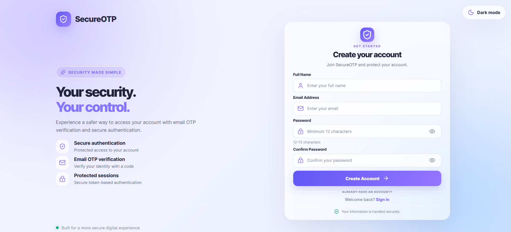</td>
    <td align="center">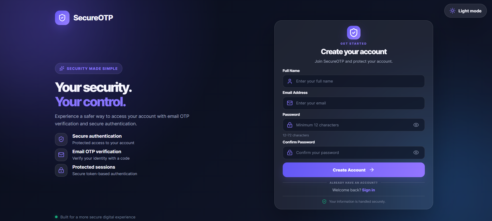</td>
  </tr>
</table>

### 2. User Login

<table>
  <tr>
    <th width="50%">Login – Light Mode</th>
    <th width="50%">Login – Dark Mode</th>
  </tr>
  <tr>
    <td align="center">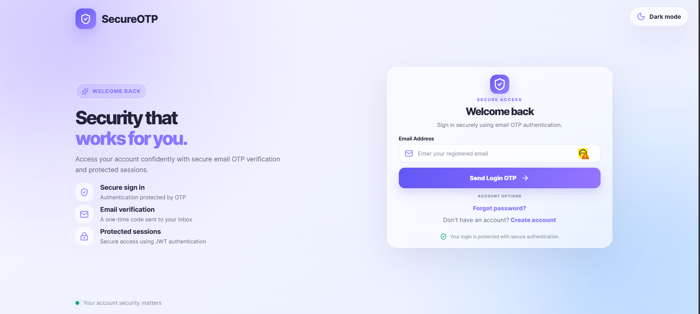</td>
    <td align="center">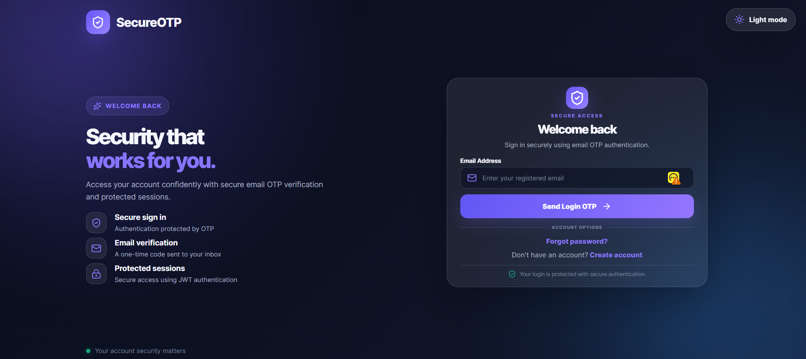</td>
  </tr>
</table>

### 3. OTP Verification

<table>
  <tr>
    <th width="50%">OTP Verification – Light Mode</th>
    <th width="50%">OTP Verification – Dark Mode</th>
  </tr>
  <tr>
    <td align="center">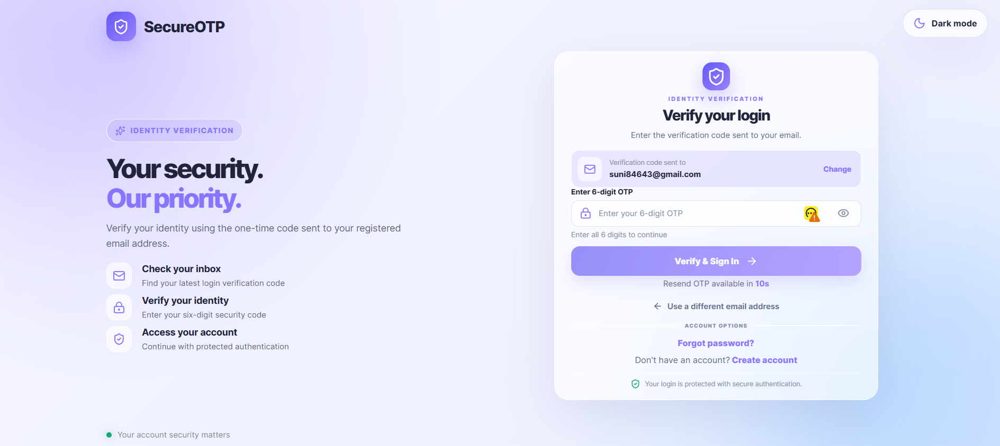</td>
    <td align="center">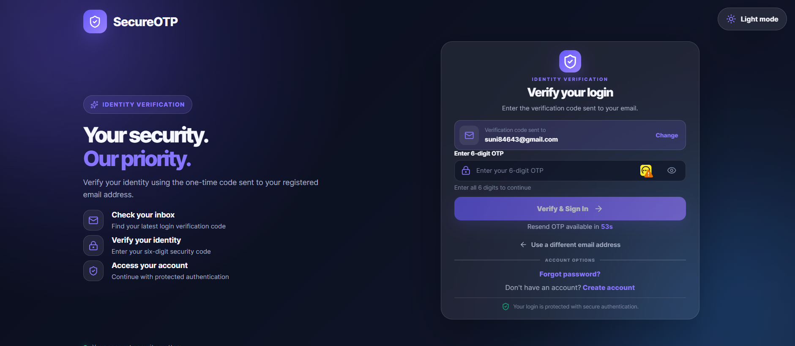</td>
  </tr>
</table>

### 4. Forgot Password

<table>
  <tr>
    <th width="50%">Forgot Password – Light Mode</th>
    <th width="50%">Forgot Password – Dark Mode</th>
  </tr>
  <tr>
    <td align="center">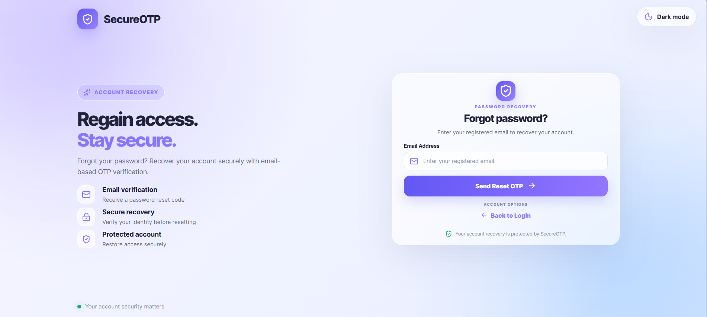</td>
    <td align="center">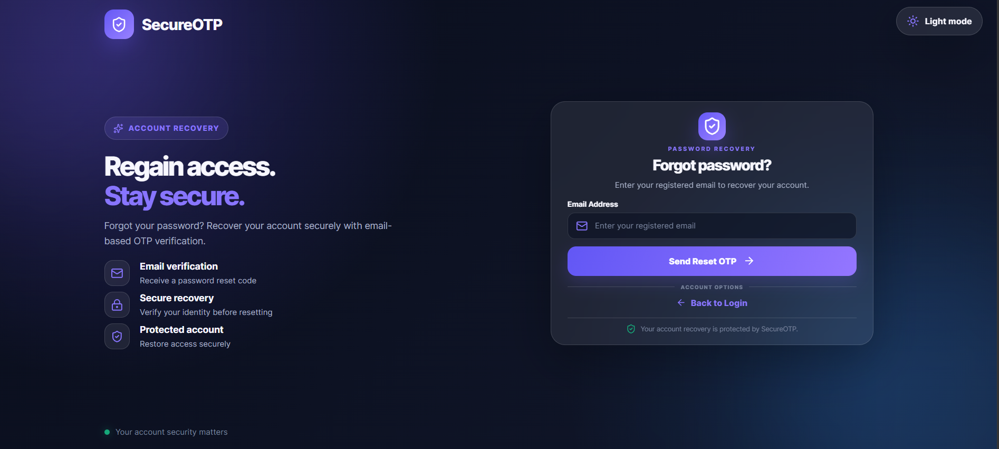</td>
  </tr>
</table>

### 5. Reset Password

<table>
  <tr>
    <th width="50%">Reset Password – Light Mode</th>
    <th width="50%">Reset Password – Dark Mode</th>
  </tr>
  <tr>
    <td align="center">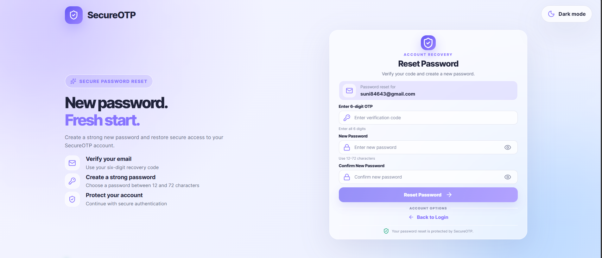</td>
    <td align="center">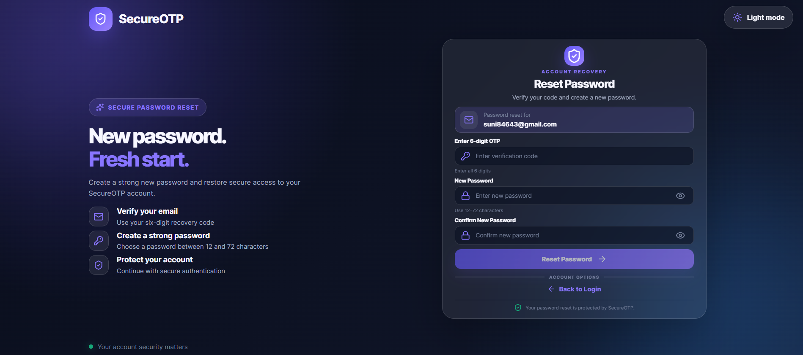</td>
  </tr>
</table>

### 6. User Dashboard

<table>
  <tr>
    <th width="50%">Dashboard – Light Mode</th>
    <th width="50%">Dashboard – Dark Mode</th>
  </tr>
  <tr>
    <td align="center">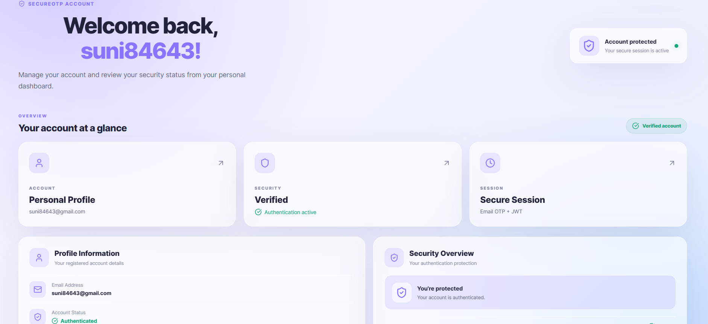</td>
    <td align="center">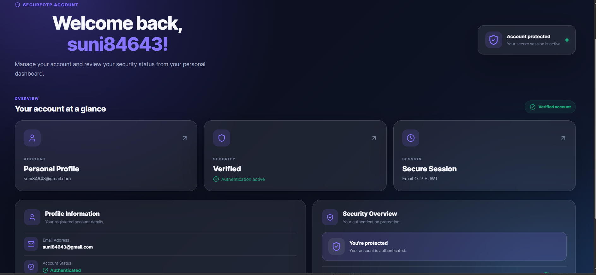</td>
  </tr>
</table>

### 7. Welcome Screens

<table>
  <tr>
    <th width="50%">Welcome – Light Mode</th>
    <th width="50%">Welcome – Dark Mode</th>
  </tr>
  <tr>
    <td align="center">
      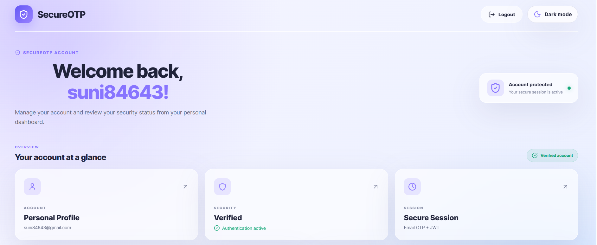
    </td>
    <td align="center">
      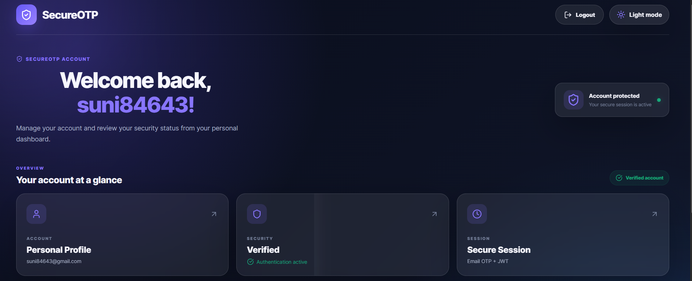
    </td>
  </tr>
</table>

---

## 🚀 Features

### 🔑 Authentication
- User registration with email OTP verification.
- Password-based account registration.
- Email OTP-based login.
- Six-digit OTP verification.
- JWT-based authentication.
- Protected routes and REST APIs.
- Secure logout and session invalidation.

### 📧 OTP Management
- Secure OTP generation.
- Email-based OTP delivery.
- OTP expiration mechanism.
- OTP verification attempt limits.
- OTP resend cooldown.
- HMAC-based OTP storage.

### 🔒 Password & Account Security
- BCrypt password hashing.
- Forgot password functionality.
- Password reset using email OTP.
- Password validation (12–72 characters).
- Refresh-token rotation.
- Refresh-token replay detection.
- IP-based rate limiting.

### 🎨 User Interface
- Modern glassmorphism UI.
- Light and dark themes.
- Responsive layouts.
- Interactive form elements.
- Password visibility toggle.
- OTP verification interface.
- User dashboard with account and security information.

---

## 🛠️ Technology Stack

### Backend
- Java 21
- Spring Boot
- Spring Security
- Spring Data JPA
- Hibernate
- JWT Authentication
- BCrypt Password Encoding
- Maven
- REST APIs

### Frontend
- React 19
- JavaScript
- Vite
- HTML5
- CSS3
- Axios
- Lucide React

### Database
- MySQL

### Development Tools
- Spring Tool Suite (STS)
- Visual Studio Code
- MySQL Workbench
- Postman
- Git
- GitHub

---

## 🏗️ System Architecture

```text
                 USER
                   |
                   v
          REACT FRONTEND
             (Vite)
                   |
                   v
             AXIOS API
                   |
                   v
          SPRING BOOT BACKEND
                   |
          +--------+--------+
          |                 |
          v                 v
    SPRING SECURITY      SERVICES
          |                 |
          v                 v
    JWT AUTHENTICATION   OTP SERVICE
          |                 |
          |                 v
          |             EMAIL SERVICE
          |                 |
          |                 v
          |             USER EMAIL
          |
          v
       JPA / HIBERNATE
                   |
                   v
                MYSQL
```

---

## 🔄 Application Workflow

### 1. Registration Workflow
1. User enters name, email, and password.
2. Frontend sends registration details to the backend.
3. Backend validates the request.
4. A verification OTP is generated and sent to the registered email.
5. User enters the OTP.
6. Backend verifies the OTP.
7. Account registration is completed.

### 2. Login Workflow
1. User enters their registered email.
2. Backend generates and sends a login OTP.
3. User enters the six-digit OTP.
4. Backend validates the OTP.
5. Authentication is completed.
6. JWT tokens are issued.
7. User is redirected to the protected dashboard.

### 3. Password Recovery Workflow
1. User enters their registered email.
2. A password-reset OTP is sent.
3. User verifies the OTP.
4. User enters a new password.
5. Backend validates the OTP and password.
6. Password is securely updated using BCrypt.

---

## 📂 Project Structure

```text
SecureOTP/
│
├── backend/
│   ├── src/
│   │   ├── main/
│   │   │   ├── java/
│   │   │   └── resources/
│   │   └── test/
│   ├── pom.xml
│   └── .gitignore
│
├── frontend/
│   ├── public/
│   ├── src/
│   │   ├── api/
│   │   ├── components/
│   │   ├── context/
│   │   ├── pages/
│   │   ├── services/
│   │   ├── App.jsx
│   │   ├── App.css
│   │   └── index.css
│   ├── package.json
│   └── .gitignore
│
├── screenshots/
│   ├── register-light.png
│   ├── register-dark.png
│   ├── login-light.png
│   ├── login-dark.png
│   ├── otp-light.png
│   ├── otp-dark.png
│   ├── forgot-password-light.png
│   ├── forgot-password-dark.png
│   ├── reset-password-light.png
│   ├── reset-password-dark.png
│   ├── dashboard-light.png
│   └── dashboard-dark.png
│
├── .gitignore
└── README.md
```

---

## ⚙️ Installation and Setup

### Prerequisites

Make sure the following tools are installed:

- Java JDK 21
- Maven
- Node.js and npm
- MySQL Server
- Git

### 1. Clone the Repository

```bash
git clone https://github.com/YOUR_USERNAME/SecureOTP.git
```

```bash
cd SecureOTP
```

### 2. Backend Setup

Navigate to the backend directory:

```bash
cd backend
```

Configure your MySQL database and required application environment variables.

Create the database:

```sql
CREATE DATABASE secureotp_db;
```

Configure the database connection, email service credentials, JWT secret, and OTP HMAC secret using environment variables or your local configuration.

Start the Spring Boot application:

```bash
mvn spring-boot:run
```

Backend runs on:

```text
http://localhost:8080
```

### 3. Frontend Setup

Open another terminal and navigate to the frontend directory:

```bash
cd frontend
```

Install dependencies:

```bash
npm install
```

Start the React development server:

```bash
npm run dev
```

Frontend runs on the Vite URL displayed in your terminal, typically:

```text
http://localhost:5173
```

---

## 🔐 Security Implementation

| Security Mechanism | Purpose |
|---|---|
| JWT | Secure authentication |
| BCrypt | Password hashing |
| HMAC | Secure OTP storage |
| OTP Expiration | Prevent reuse of expired codes |
| OTP Attempt Limits | Limit repeated verification attempts |
| Resend Cooldown | Prevent excessive OTP requests |
| Refresh Token Rotation | Improve session security |
| Replay Detection | Detect refresh-token reuse |
| IP Rate Limiting | Reduce automated abuse |
| Spring Security | Protect backend APIs |

---

## 🎯 Learning Outcomes

Through this project, I gained practical experience in:

- Building a full-stack application using Java and React.
- Developing RESTful APIs using Spring Boot.
- Implementing email-based OTP authentication.
- Working with Spring Security and JWT.
- Implementing secure password hashing.
- Integrating React with Spring Boot APIs.
- Managing authentication and protected routes.
- Working with MySQL and Spring Data JPA.
- Implementing token and OTP security mechanisms.
- Designing responsive interfaces with light and dark themes.

---

## 🔮 Future Enhancements

The following features are planned for future versions:

- Google OAuth 2.0 authentication.
- Authenticator-app-based two-factor authentication.
- Active session and device management.
- Login history and security activity logs.
- Admin dashboard and user management.
- Redis-based OTP management and distributed rate limiting.
- Docker containerization.
- CI/CD using GitHub Actions.
- Passkey authentication.

---

## 👨‍💻 Developer

**Sunil J S**

Java Full Stack Developer | BE Computer Science & Engineering

Interested in building secure, scalable, and user-friendly full-stack applications using Java, Spring Boot, React, and modern technologies.

---

## ⭐ Support

If you find this project useful or interesting, consider giving this repository a ⭐ on GitHub.

**SecureOTP – Your Security. Your Control.** 🔐